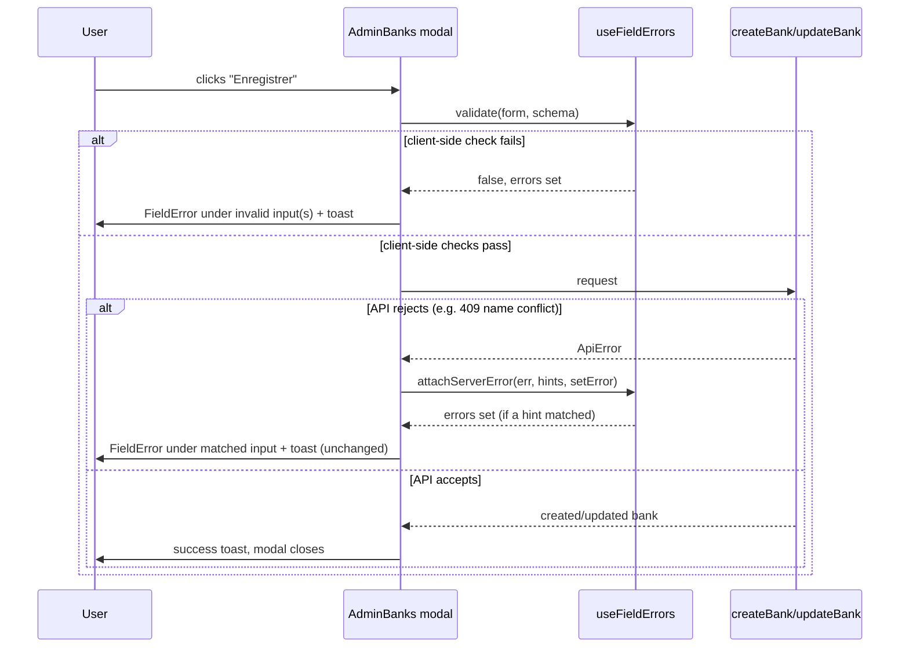

# Inline Form Field Validation, Design

**Date:** 2026-09-08
**Status:** Approved (pending written-spec review)

## Context

Every Add/Edit modal in the admin app (banks, users, dimensions/questions,
recommendations, framework versions, scoring weights, veille circulars,
account/profile, settings, notifications — roughly ten independent pages)
follows the same hand-rolled pattern: a `handleSubmit` that checks one or two
required fields, and on the first miss shows a single `sonner` toast (e.g.
*"Champ manquant — Le nom de la banque est obligatoire."*). This has three
concrete problems:

1. **Incomplete coverage.** Only some fields are checked (e.g.
   `AdminBanks.tsx` only checks `name`; other fields like email format
   anywhere else aren't checked at all client-side).
2. **No per-field feedback.** The toast names one field in prose; the user
   isn't shown *which input* is wrong, so on a form with several fields they
   have to guess.
3. **Untranslated fallback.** When a required/format problem isn't caught
   client-side, it reaches the backend, which returns FastAPI's structured
   422 body (`{"detail": [{"loc": [...], "msg": "field required"}, ...]}`).
   `frontend/src/lib/api.ts`'s `errorDetail()` flattens this into a string
   like `"email : field required"` — Pydantic's default messages are
   **English**, verified in `api.ts:21-56`. This is the concrete mechanism
   behind "the error isn't in French": it's not a mistranslated message, it's
   an un-caught client-side check falling through to the backend's own
   (English) validation error.

Verified in code (not assumed):
- No `<form>` element or validation library is used by these modals — all
  are controlled `useState` + a `handleSubmit` that calls the API directly.
  `frontend/package.json` has no `zod`/`yup`/`react-hook-form`.
- `errorMessage()` (turns a caught error into toast text) is duplicated
  verbatim in at least three pages (`AdminBanks.tsx`, `AdminUsers.tsx`,
  `AdminScoring.tsx`) rather than shared.
- `ApiError` (`frontend/src/lib/api.ts`) already carries the **unflattened**
  raw response body on `.body`, alongside the flattened `.message` string —
  so a 422's structured `{loc, msg}` pairs are still recoverable from a
  caught `ApiError`, they're just not used today.
- The app's existing danger palette (`VersionDetail.tsx:28-30,159-163`):
  text `#B91C1C`, background `#FEF2F2`, border `#FECACA`, paired with lucide's
  `AlertCircle` icon — the same triad the Keycloak login theme already uses
  for its own error alerts. No new color is being introduced.
- Admin pages mix two styling conventions: inline `style={}` objects
  (`AdminBanks.tsx`) and Tailwind utility classes (elsewhere). A shared
  solution has to work with both, not force one.
- Four files at the repo root (`DimensionsManagement.tsx`,
  `RecommendationCatalog.tsx`, `VersionDetail.tsx`,
  `QuestionnaireVersions.tsx`) look like duplicates of pages under
  `frontend/src/pages/superAdmin/` but are confirmed **not imported
  anywhere** (`routes.tsx` imports the `superAdmin/` versions). Out of scope,
  not touched by this work.

**Out of scope for this pass:** the questionnaire-taking flow
(`QuestionnairePage.tsx`) isn't an add/edit CRUD form in this sense (radio-
button answers, not free text with required/format rules) and isn't part of
this sweep.

## Decisions

| Question | Decision | Why |
|---|---|---|
| Validation mechanism | Hand-rolled hook + validator functions, no new dependency | Matches the app's existing controlled-input style exactly; adopting `react-hook-form`/`zod` would mean restructuring every form's field registration for marginal benefit at this scale |
| Toast vs. inline | Keep a toast as a summary, add inline per-field errors alongside it | Toast still announces "submission failed" at a glance; inline errors say exactly which field and why. For a *client-side* validation failure the toast text becomes one generic line ("Corrigez les champs en rouge.") since inline messages now carry the specific detail and a form can fail several fields at once; a *server-side* rejection (409/422 reaching the catch block) keeps its existing per-case toast text unchanged, inline errors are added alongside it, not instead of it |
| Server-error mapping | Map to a field when the response identifies one (422 `loc`, or a regex hint per page for string details); otherwise fall back to the toast unchanged | Honest about what's mappable — a 409's plain-string detail ("Une banque porte déjà ce nom.") has no structured field info, so per-page keyword hints are the only way to attach it, and only where a page opts in |
| Rollout | Phase 1: shared primitives + `AdminBanks.tsx` only, for review. Phase 2: remaining ~9 pages, planned separately | Validates the pattern on one real page before repeating it nine more times |

## Architecture

New files:

- **`frontend/src/lib/validation.ts`** — pure functions, each returning a
  French error string or `undefined`. Building only what Phase 1 actually
  uses (YAGNI: `AdminBanks.tsx` has one required field and one optional
  email field, nothing else):
  - `required(value: string): string | undefined` — fails on empty/whitespace.
  - `email(value: string): string | undefined` — format check, **skips
    (returns `undefined`) when `value` is empty**, so it composes cleanly
    with an *optional* field (`contact`, placeholder `prenom.nom@banque.tn`
    in `AdminBanks.tsx:317`, sent as `null` when blank) — only `required`
    enforces presence; format validators only judge what's actually typed.
  - `runValidators<T>(values: T, schema: {[K in keyof T]?: (v: T[K]) => string | undefined}): Partial<Record<keyof T, string>>` —
    applies every rule in `schema` against `values`, returns only the
    entries that failed.
  - Phase 2 pages add whatever narrow rule they need (e.g. `minLength`, a
    URL check for a circular's source link) as one more small function
    here when a page actually needs it, not speculatively now.

- **`frontend/src/hooks/useFieldErrors.ts`** — one hook, reused by every
  page:
  ```ts
  function useFieldErrors<T extends Record<string, unknown>>() {
    const [errors, setErrors] = useState<Partial<Record<keyof T, string>>>({});
    function validate(values: T, schema: ValidatorSchema<T>): boolean { ... }
    function clearError(field: keyof T): void { ... }
    function setError(field: keyof T, message: string): void { ... }
    function reset(): void { ... }
    return { errors, validate, clearError, setError, reset };
  }
  ```
  `validate` both sets state and returns a boolean so `handleSubmit` can
  `if (!validate(values, schema)) return;` before ever calling the API.
  `reset()` is called wherever the modal already resets its form state on
  open/close, so errors from a previous session don't linger.

- **`frontend/src/lib/serverError.ts`** — `attachServerError(err, fieldHints, setError): boolean`:
  - `err: unknown` (narrowed to `ApiError`; non-`ApiError` values are a no-op).
  - `fieldHints: Partial<Record<keyof T, RegExp>>`, page-supplied, e.g.
    `{ name: /nom/i }` for the bank-name conflict.
  - If `err.body`'s `detail` is an array (422): map each entry's `loc`
    (last segment) straight to a field, using the entry's raw Pydantic
    `msg` for now for anything not already caught client-side (this path
    should be rare once Phase 1's client-side checks are in place — it's a
    defensive fallback, not the primary UX).
  - Else if `err.message` matches one of `fieldHints`: `setError(field, err.message)`.
  - Returns whether it attached anything, purely so a call site *could*
    choose to skip the toast in that case — Phase 1 doesn't use this;
    the toast fires unconditionally either way (Decision table above).

- **`frontend/src/components/FieldError.tsx`** — presentational only:
  ```tsx
  export function FieldError({ message }: { message?: string }) {
    if (!message) return null;
    return (
      <p style={{ marginTop: 4, fontSize: 12, color: "#B91C1C", display: "flex", alignItems: "center", gap: 4 }}>
        <AlertCircle size={12} /> {message}
      </p>
    );
  }
  ```
  Works under either styling convention (inline-style pages or Tailwind
  pages) since it's a self-contained leaf component.

Modified files (Phase 1):

- **`frontend/src/pages/superAdmin/AdminBanks.tsx`** — the Add/Edit Bank
  modal (`handleSubmit`, `name`/`country`/`sector`/`contact`/`description`
  inputs):
  - Schema: `name` → `required`, `contact` → `email` (format-only, skipped
    when blank since `contact` is optional); `country`/`sector`/`description`
    stay unvalidated (matches current backend contract — only `name` is
    non-nullable, and nothing else has a format constraint).
  - `handleSubmit` calls `validate(form, schema)` first; on failure, fires a
    generic summary toast (`"Corrigez les champs en rouge."`, replacing
    today's field-specific `"Champ manquant"` toast, see Decision table)
    and returns before calling `createBank`/`updateBank`.
  - Each input gets `<FieldError message={errors.<field>} />` under it, and
    its existing inline `style={inp}` gets `borderColor: errors.<field> ? "#FECACA" : ...`
    merged in when invalid.
  - Each input's `onChange` calls `clearError('<field>')` alongside its
    existing `setForm` update.
  - The `catch` block calls `attachServerError(err, { name: /nom/i }, setError)`
    before the existing `toast.error(...)` (unchanged) — so the "Une banque
    porte déjà ce nom." 409 now also puts a red border + message under the
    Name field, in addition to the toast it already produces.

Not touched in Phase 1: `errorMessage()`'s duplication across three files is
a real gap (noted above) but is a separate, unrelated cleanup — fixing it
isn't necessary to deliver this feature and would widen the diff without
serving it, so it's left alone here. It can become an item in the same pass
if a future page's rollout naturally passes through those files.

## Data flow (submit path)



## Testing

- Manual: submit the Add Bank modal empty → Name shows a red border +
  "Ce champ est obligatoire." underneath, summary toast fires, no request sent.
- Manual: fill Name, type a malformed value in "Contact principal" (e.g.
  "abc") → submit blocked, Contact shows its own inline format error, Name
  shows none.
- Manual: type a name matching an existing bank → submit → 409 comes back,
  Name field shows "Une banque porte déjà ce nom." inline (in addition to
  the existing toast).
- Manual: fix the field → red state clears immediately on keystroke, before
  re-submitting.
- `tsc --noEmit` on `frontend/` to confirm the new generic hook/helpers type
  correctly against `AdminBanks.tsx`'s existing `form` shape.

## Phase 2 (separate follow-up, not built now)

Once Phase 1 is confirmed, the same five-step convention (schema → validate-
before-submit → `FieldError` per input → `clearError` on change →
`attachServerError` in the catch) gets applied to the remaining pages:
`AdminUsers.tsx`, `AdminDimensions.tsx` (dimension/sub-dimension/question
modals), `AdminRecommendations.tsx`, `AdminVersions.tsx`/`frameworkStaging.tsx`,
`AdminScoring.tsx`, `AdminVeille.tsx` (admin + superAdmin), `AdminAccount.tsx`/
`ProfilePage.tsx`, `AdminSettings.tsx` (admin + superAdmin), `NotificationsPanel.tsx`.
Each page needs its own small schema + `fieldHints`, sized to its actual
fields — that per-page detail belongs in the implementation plan for that
phase, not here.
